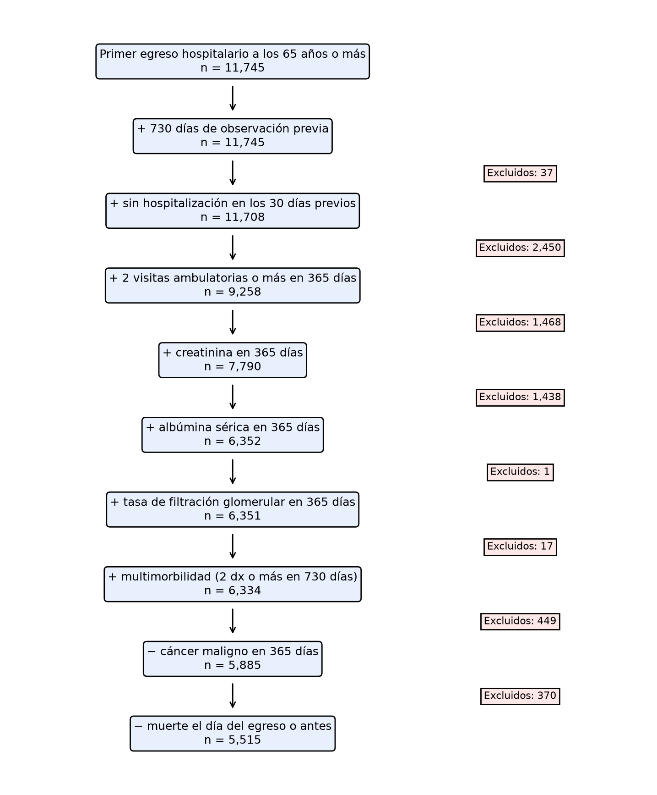
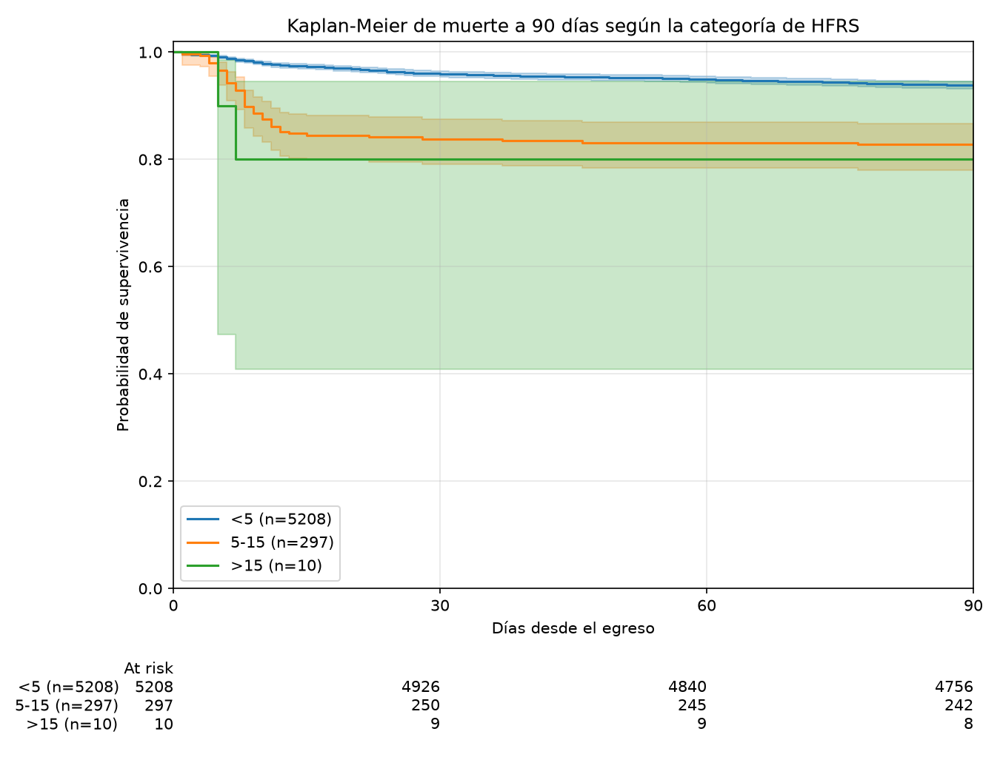

# Desenlaces adversos a 90 días en personas mayores egresadas de una hospitalización, mediante un modelo que conjunta el HFRS con variables clínicas y/o bioquímicas. 

[](https://github.com/alejandroeliu-sys/fragilidad-hfrs-90d/actions/workflows/ci.yml)

Se presenta aquí un avance intermedio del proyecto final, es  modalidad de modelo clínico predictivo. Incluye la cohorte 1701, el Hospital Frailty Risk Score (HFRS), los desenlaces a 90 días, la Tabla 1 y un análisis de supervivencia preliminar, sobre una base sintética Synthea convertida a OMOP.

## Objetivo

Predecir desenlaces adversos a 90 días (muerte, reingreso o visita a urgencias) en personas de 65 años o más que egresan de una hospitalización, usando el HFRS de Gilbert et al. (2018) como modelo de referencia (M0).

## Datos sintéticos

La base de trabajo es `omop_20k.duckdb` (Synthea → OMOP CDM). Vive fuera del repositorio, en `~/s12-omop-cdm-introduccion/omop_20k.duckdb`, y se abre en modo solo lectura. Los datos son 100 % sintéticos. Los CSV de resultados (`data/`) y la base `.duckdb` están en `.gitignore`. Las versiones de la lista de referencia estan en `referencias/`.

## Para reproducir

Es necesario Python 3.14 y la base OMOP.

```bash
cd ~/fragilidad-hfrs-90d
source ~/venv_go/bin/activate
pip install -r requirements.txt
```

Los scripts se lanzan desde la raíz del repositorio, porque las rutas `sql/` y `referencias/` son relativas:

```bash
BASE=~/s12-omop-cdm-introduccion/omop_20k.duckdb

python src/fragilidad/atricion.py $BASE                          # docs/atricion.md
PYTHONPATH=src python src/fragilidad/diagrama_flujo.py $BASE     # figuras/flujo_cohorte.png
python src/fragilidad/hfrs.py $BASE                              # data/hfrs_cohorte.csv
PYTHONPATH=src python src/fragilidad/desenlaces.py $BASE         # data/desenlaces_cohorte.csv
PYTHONPATH=src python src/fragilidad/tabla1.py $BASE             # docs/tabla1.md
PYTHONPATH=src python src/fragilidad/supervivencia.py $BASE      # docs/supervivencia.md y figuras/km_*.png
```

Pruebas (no necesitan la base Synthea; usan datos de ejemplo en memoria):

```bash
PYTHONPATH=src pytest -q
```

Con contenedor (probado con Podman 5.8; los mismos comandos sirven con `docker`):

```bash
podman build -t fragilidad-hfrs-90d .
podman run --rm fragilidad-hfrs-90d
```

En cada push, GitHub Actions corre las pruebas y gitleaks (`.github/workflows/ci.yml`).

## Estructura del repositorio

```
sql/                      Cohorte, HFRS, desenlaces y características basales
src/fragilidad/           Atrición, diagrama, HFRS, desenlaces, Tabla 1 y supervivencia
tests/                    pytest con datos de ejemplo
referencias/              Lista oficial de códigos HFRS y puente SNOMED
docs/                     Atrición, Tabla 1, supervivencia, diccionario, limitaciones y uso de IA
figuras/                  Diagrama de flujo y curvas de Kaplan-Meier
data/                     CSV de resultados (no se versionan)
.github/workflows/ci.yml  pytest y gitleaks
Dockerfile                Imagen que instala dependencias y corre pytest
```

## Resultados preliminares

### Cohorte y HFRS

Cohorte:**5,515 personas** (atrición desde 11,745; detalle en [`docs/limitaciones.md`](docs/limitaciones.md)).



| Categoría HFRS | Personas | % |
|---|---:|---:|
| Bajo (<5) | 5,208 | 94.4 % |
| Intermedio (5 a 15) | 297 | 5.4 % |
| Alto (>15) | 10 | 0.2 % |

Mediana 0.6; máximo 19.1. La distribución está muy comprimida porque Synthea casi no genera diagnósticos geriátricos.

### Desenlaces a 90 días

| Desenlace (días 1 a 90) | Personas | % |
|---|---:|---:|
| Muerte | 369 | 6.7 % |
| Reingreso (visita 9201) | 910 | 16.5 % |
| Urgencias (visita 9203) | 1,082 | 19.6 % |
| Compuesto | 2,051 | 37.2 % |
| Seguimiento incompleto | 143 | 2.6 % |

### Tabla 1

5,372 personas con seguimiento completo (5,003 sobreviven, 369 mueren). Quienes mueren tienen mayor HFRS (mediana 2.0 vs 0.6, p < 0.001), más edad (78 vs 74 años), más insuficiencia cardiaca (56.6 % vs 16.0 %) y más demencia (14.9 % vs 10.6 %). Algunas diferencias de función renal son poco plausibles y se discuten en limitaciones. Tabla completa en [`docs/tabla1.md`](docs/tabla1.md).

### Supervivencia (muerte a 90 días)



- Log-rank por categorías de HFRS: χ² = 64.62, 2 gl, p < 0.001. Por terciles de la muestra: χ² = 103.03, p < 0.001.
- Cox con HFRS continuo: HR 1.08 por punto (IC 95 % 1.05-1.11), C-index 0.578. Ajustado por edad y sexo: HR 1.07 (1.04-1.10), C-index 0.617.
- Terciles (referencia T1): T2 HR 0.74 (0.56-0.97); T3 HR 2.54 (2.02-3.20).
- La prueba de riesgos proporcionales rechaza la proporcionalidad para el HFRS (p < 0.001).

Detalle en [`docs/supervivencia.md`](docs/supervivencia.md).

## Limitaciones

La base es sintética, el HFRS quedó comprimid en una de las categorias (10 personas en la categoría alta), los terciles no son del mismo tamaño , la función renal y la albúmina sérica  muestra asociaciones poco plausibles desde el punto de vista clínico, hay sesgo de registro en hemoglobina y no se cumple el supuesto de riesgos proporcionales. Todo eso motiva la validación externa en MIMIC-IV Demo. Detalle en [`docs/limitaciones.md`](docs/limitaciones.md) y diccionario en [`docs/diccionario_datos.md`](docs/diccionario_datos.md).

## Pendiente para la entrega final

Modelos anidados M1 a M3, XGBoost con SHAP, curvas ROC y de calibración, AUPRC, incidencia acumulada con prueba de Gray (reingreso y urgencias), validación en MIMIC-IV Demo y `MODEL_CARD.md`.

## Declaración de uso de IA

Se usó un asistente de inteligencia artificial (Grok Bot) como tutor para explicar líneas de código, especialmente en SQL . Yo ejecuté y verifiqué cada paso. La declaración completa está en [`docs/uso_ia.md`](docs/uso_ia.md).
