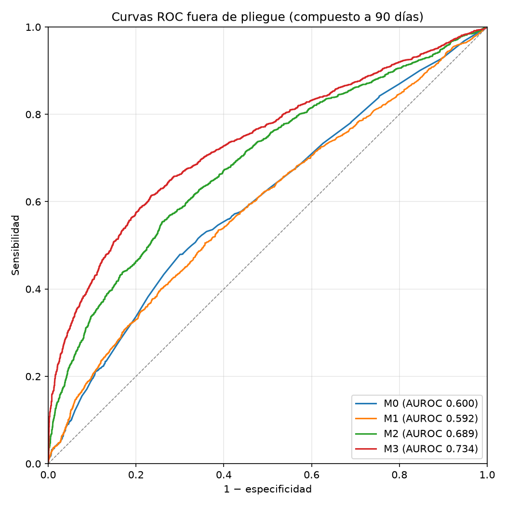
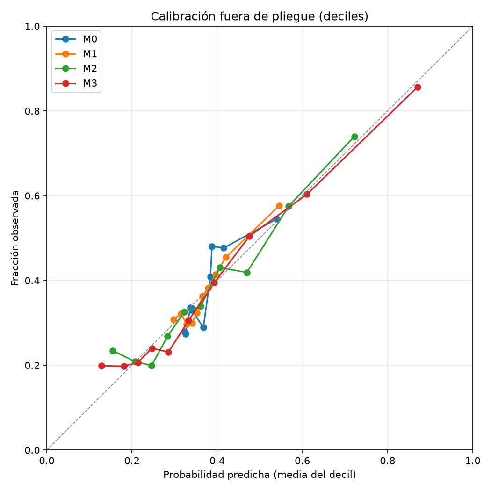

# Modelos anidados del desenlace compuesto a 90 días

M0 es el HFRS solo (estándar de referencia). M1 agrega edad y sexo; M2, comorbilidades, fármacos inferidos y número de ingredientes; M3, laboratorios, utilización y estancia índice. En M3 se conservan los valores de `albumina_ultima`, `creatinina_ultima`, `tfge_ultima` y el resto de laboratorios preespecificados, aunque no hayan sido significativos en el univariado; solo se excluyen los indicadores `albumina_falta`, `creatinina_falta` y `tfge_falta` por inestabilidad. Se conservan los demás `_falta`. Los huecos de los laboratorios se imputan con la mediana dentro de cada pliegue (solo con el entrenamiento).

La discriminación se evalúa con logística sin penalización (`C=np.inf`) sobre el compuesto binario, en 5,372 personas con `seguimiento_completo` (2,009 eventos, prevalencia 37.4 %). Validación cruzada estratificada de 5 pliegues (semilla 42), con predicciones fuera de pliegue. En cada pliegue la mediana de imputación se calcula solo en el entrenamiento; se descartan columnas constantes, totalmente vacías o duplicadas exactas. En la logística se estandariza con media y DE del entrenamiento solo para que el ajuste converja (el modelo sin penalización es equivalente). El Cox de M3 no se estandariza: sus HR quedan por unidad natural (el HFRS, por punto). AUROC, AUPRC y la diferencia de AUROC frente a M0 llevan IC 95 % bootstrap percentil (1000 réplicas, la misma semilla; las comparaciones van pareadas).

## Discriminación

| Modelo | Predictores | AUROC [IC 95%] | AUPRC [IC 95%] | ΔAUROC vs M0 [IC 95%] |
|---|---:|---|---|---|
| M0 | 1 | 0.600 [0.584-0.617] | 0.471 [0.449-0.493] | — |
| M1 | 3 | 0.592 [0.576-0.609] | 0.472 [0.449-0.495] | -0.009 [-0.019-0.001] |
| M2 | 15 | 0.689 [0.674-0.705] | 0.599 [0.576-0.622] | 0.089 [0.071-0.107] |
| M3 | 37 | 0.734 [0.720-0.749] | 0.672 [0.649-0.693] | 0.134 [0.114-0.152] |

La AUPRC de un clasificador nulo (prevalencia) sería 0.374.

## Calibración fuera de pliegue

La pendiente es el coeficiente de `logit(p)` al recalar la logística (1 = ideal). La calibración-en-lo-grande es la diferencia entre la fracción observada y la probabilidad media predicha (0 = ideal).

| Modelo | Pendiente | Calibración-en-lo-grande (obs − pred) |
|---|---:|---:|
| M0 | 0.99 | +0.000 |
| M1 | 0.96 | -0.000 |
| M2 | 0.97 | -0.000 |
| M3 | 0.90 | +0.000 |

## Cox multivariable de M3

Personas con tiempo > 0: 5,494; eventos: 2,051. C-index aparente (en la misma muestra, no es validación cruzada): 0.695. Columnas usadas tras imputar y quitar constantes o duplicadas: 37 de 37 especificadas. Sin penalización (`penalizer=0`).

| Variable | HR [IC 95%] | p |
|---|---|---:|
| `hfrs` | 1.03 [1.02-1.05] | <0.001 |
| `edad` | 1.010 [1.003-1.018] | 0.008 |
| `sexo_masc` | 1.01 [0.92-1.11] | 0.854 |
| `dm2_dx` | 1.10 [0.98-1.23] | 0.114 |
| `ic_dx` | 1.98 [1.59-2.47] | <0.001 |
| `erc_dx` | 1.45 [1.20-1.75] | <0.001 |
| `demencia_dx` | 1.21 [1.04-1.40] | 0.014 |
| `cardiop_isq_dx` | 0.91 [0.80-1.05] | 0.189 |
| `hta_dx` | 1.08 [0.96-1.22] | 0.215 |
| `anemia_dx` | 0.91 [0.82-1.01] | 0.088 |
| `n_ingredientes_365` | 0.95 [0.93-0.97] | <0.001 |
| `n_ingredientes_30` | 1.16 [1.14-1.18] | <0.001 |
| `dm_inferida` | 1.01 [0.84-1.21] | 0.944 |
| `hta_inferida` | 0.76 [0.66-0.88] | <0.001 |
| `ic_inferida` | 0.93 [0.76-1.13] | 0.458 |
| `albumina_ultima` | 0.97 [0.89-1.06] | 0.518 |
| `albumina_n` | 1.000 [0.983-1.016] | 0.963 |
| `albumina_pendiente` | 1.0006 [0.9968-1.0044] | 0.760 |
| `albumina_de` | 7.35 [4.59-11.78] | <0.001 |
| `creatinina_ultima` | 1.003 [0.991-1.015] | 0.654 |
| `creatinina_n` | 1.001 [0.994-1.008] | 0.762 |
| `creatinina_pendiente` | 0.983 [0.977-0.989] | <0.001 |
| `urea_ultima` | 0.999 [0.986-1.011] | 0.824 |
| `urea_n` | 1.024 [1.009-1.040] | 0.002 |
| `urea_pendiente` | 0.999 [0.995-1.004] | 0.723 |
| `hemoglobina_ultima` | 1.04 [1.01-1.07] | 0.006 |
| `tfge_ultima` | 1.0012 [0.9992-1.0032] | 0.239 |
| `pas_ultima` | 1.0005 [0.9976-1.0034] | 0.718 |
| `imc_ultimo` | 1.010 [0.989-1.031] | 0.376 |
| `n_ambulatorias_365` | 0.991 [0.987-0.994] | <0.001 |
| `n_hosp_365` | 1.15 [1.09-1.21] | <0.001 |
| `n_urgencias_365` | 1.035 [1.024-1.046] | <0.001 |
| `estancia_indice_dias` | 0.994 [0.979-1.008] | 0.392 |
| `urea_falta` | 1.05 [0.88-1.25] | 0.587 |
| `hemoglobina_falta` | 1.40 [1.18-1.65] | <0.001 |
| `pas_falta` | 0.55 [0.13-2.42] | 0.429 |
| `imc_falta` | 1.25 [0.31-5.08] | 0.759 |

`creatinina_ultima` y `tfge_ultima` entran juntas en M3. Están colineales (la TFGe se deriva de la creatinina), así que sus HR ajustados son difíciles de interpretar por separado; la predicción (AUROC, AUPRC, C-index) no se afecta por esa colinealidad. Si la función renal no se asocia con el compuesto, hay que leerlo como un artefacto de Synthea, no como un hallazgo clínico.

### Riesgos proporcionales (prueba de Schoenfeld, transformación rank)

| Variable | Estadístico | p |
|---|---:|---:|
| `albumina_de` | 46.61 | <0.001 |
| `albumina_n` | 26.87 | <0.001 |
| `albumina_pendiente` | 0.96 | 0.328 |
| `albumina_ultima` | 0.32 | 0.574 |
| `anemia_dx` | 3.29 | 0.070 |
| `cardiop_isq_dx` | 0.64 | 0.423 |
| `creatinina_n` | 3.29 | 0.070 |
| `creatinina_pendiente` | 1.05 | 0.304 |
| `creatinina_ultima` | 0.36 | 0.548 |
| `demencia_dx` | 5.35 | 0.021 |
| `dm2_dx` | 0.09 | 0.763 |
| `dm_inferida` | 1.18 | 0.278 |
| `edad` | 4.33 | 0.037 |
| `erc_dx` | 33.80 | <0.001 |
| `estancia_indice_dias` | 44.69 | <0.001 |
| `hemoglobina_falta` | 14.19 | <0.001 |
| `hemoglobina_ultima` | 0.06 | 0.807 |
| `hfrs` | 4.28 | 0.039 |
| `hta_dx` | 0.20 | 0.651 |
| `hta_inferida` | 5.79 | 0.016 |
| `ic_dx` | 4.98 | 0.026 |
| `ic_inferida` | 0.41 | 0.524 |
| `imc_falta` | 0.03 | 0.864 |
| `imc_ultimo` | 1.68 | 0.196 |
| `n_ambulatorias_365` | 5.36 | 0.021 |
| `n_hosp_365` | 24.06 | <0.001 |
| `n_ingredientes_30` | 122.72 | <0.001 |
| `n_ingredientes_365` | 3.99 | 0.046 |
| `n_urgencias_365` | 5.32 | 0.021 |
| `pas_falta` | 0.47 | 0.491 |
| `pas_ultima` | 2.34 | 0.126 |
| `sexo_masc` | 1.75 | 0.186 |
| `tfge_ultima` | 6.03 | 0.014 |
| `urea_falta` | 5.85 | 0.016 |
| `urea_n` | 0.04 | 0.840 |
| `urea_pendiente` | 0.03 | 0.856 |
| `urea_ultima` | 0.97 | 0.325 |

17 covariable(s) tienen p < 0.05 en la prueba de proporcionalidad; su HR se interpreta como un promedio a lo largo del seguimiento.

## Limitaciones

- Los pliegues son aleatorios estratificados, no un corte temporal por `fecha_indice`.
- La imputación por mediana (aunque solo se ajuste en el entrenamiento) es simple; en pendientes y desviaciones hay muchos huecos porque exigen al menos tres días con medición.
- El C-index del Cox es aparente (se estima y se evalúa en la misma muestra).
- El Cox no se estandariza; un HR cercano a 1 por unidad natural puede seguir siendo relevante (edad por año, HFRS por punto).
- M0-M3 están preespecificados; no hay selección automática de variables.
- La creatinina y la TFGe son colineales: no se interprete cada HR ajustado por separado. La falta de asociación de la función renal con el compuesto es un artefacto de Synthea.
