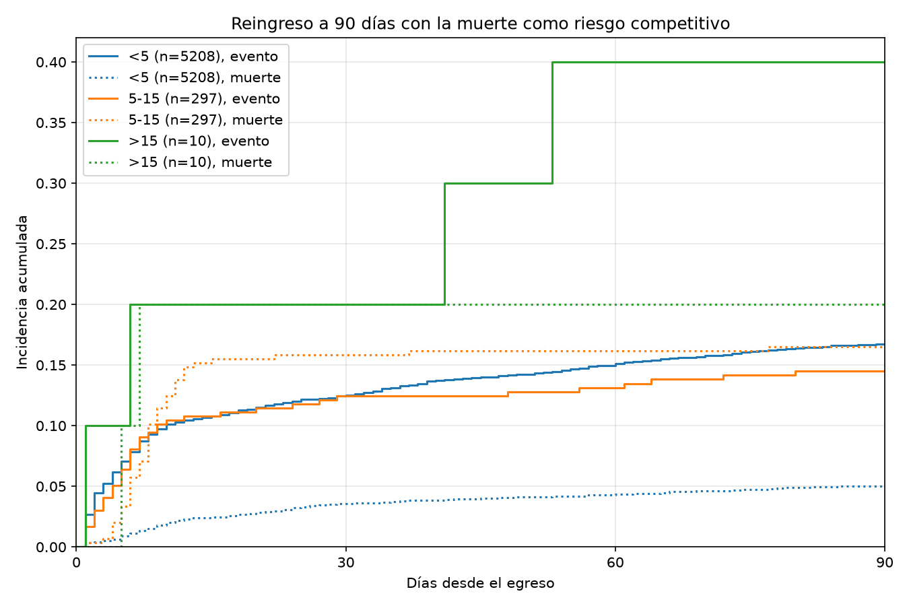
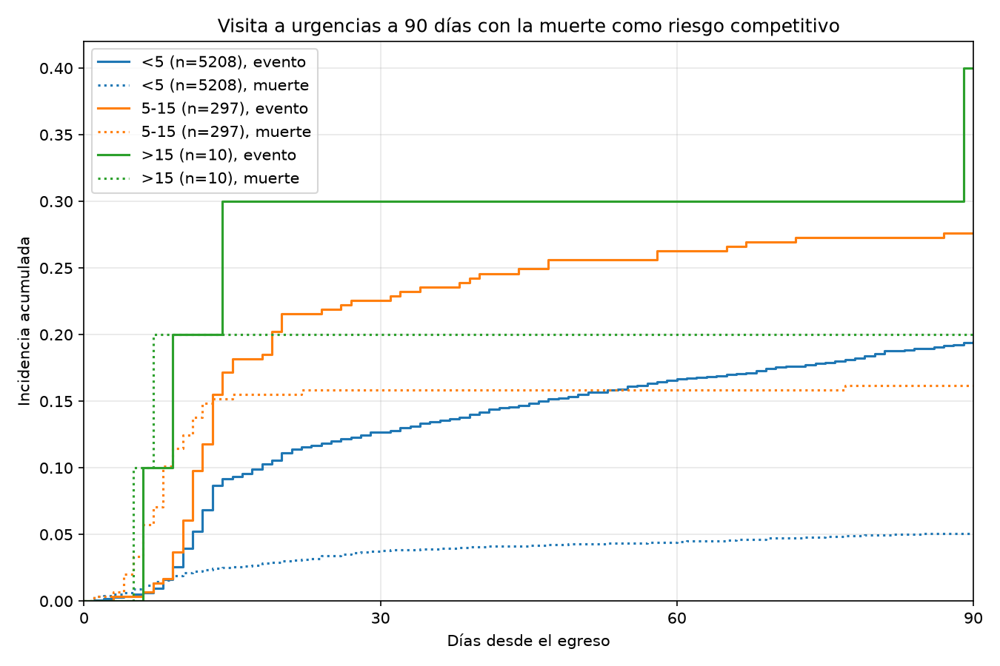

# Riesgos competitivos a 90 días según el HFRS

Personas: 5,515. Día 0 = egreso. Tipo 1 = el evento llegó primero; tipo 2 = la muerte llegó primero (riesgo competitivo); tipo 0 = censura en el mínimo entre `dias_seguimiento` y 90. Si el evento y la muerte caen el mismo día, cuenta el evento. La incidencia acumulada es la de Aalen-Johansen y la comparación entre grupos, la prueba de Gray (rho = 0, como `cmprsk::cuminc` en R).

## Reingreso

| Grupo | n | Eventos | Muertes primero | % a 30 días | % a 90 días | % muerte a 90 días |
|---|---:|---:|---:|---:|---:|---:|
| <5 | 5,208 | 863 | 260 | 12.5 | 16.7 | 5.1 |
| 5-15 | 297 | 43 | 49 | 12.5 | 14.5 | 16.5 |
| >15 | 10 | 4 | 2 | 20.0 | 40.0 | 20.0 |
| T1 | 2,811 | 574 | 122 | 15.7 | 20.7 | 4.4 |
| T2 | 1,775 | 230 | 66 | 9.6 | 13.1 | 3.8 |
| T3 | 929 | 106 | 123 | 8.7 | 11.4 | 13.3 |

| Prueba de Gray | Estadístico | gl | p |
|---|---:|---:|---:|
| Categorías HFRS | 4.81 | 2 | 0.090 |
| Terciles (sensibilidad) | 66.72 | 2 | <0.001 |

## Visita a urgencias

| Grupo | n | Eventos | Muertes primero | % a 30 días | % a 90 días | % muerte a 90 días |
|---|---:|---:|---:|---:|---:|---:|
| <5 | 5,208 | 996 | 261 | 12.7 | 19.4 | 5.1 |
| 5-15 | 297 | 82 | 48 | 22.6 | 27.6 | 16.2 |
| >15 | 10 | 4 | 2 | 30.0 | 40.0 | 20.0 |
| T1 | 2,811 | 300 | 130 | 5.5 | 10.9 | 4.7 |
| T2 | 1,775 | 495 | 58 | 20.3 | 28.3 | 3.3 |
| T3 | 929 | 287 | 123 | 23.0 | 31.0 | 13.3 |

| Prueba de Gray | Estadístico | gl | p |
|---|---:|---:|---:|
| Categorías HFRS | 16.39 | 2 | <0.001 |
| Terciles (sensibilidad) | 300.84 | 2 | <0.001 |

## Limitaciones

El grupo >15 tiene 10 personas, así que su curva es inestable. Los terciles salieron en 3 grupo(s) por los empates del HFRS. La prueba de Gray compara las incidencias acumuladas, no las tasas de evento entre quienes siguen vivos.
