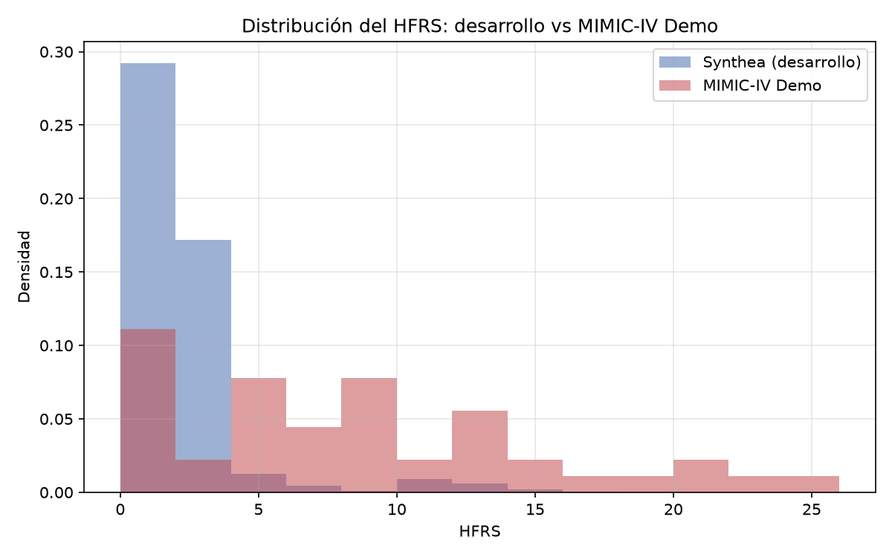
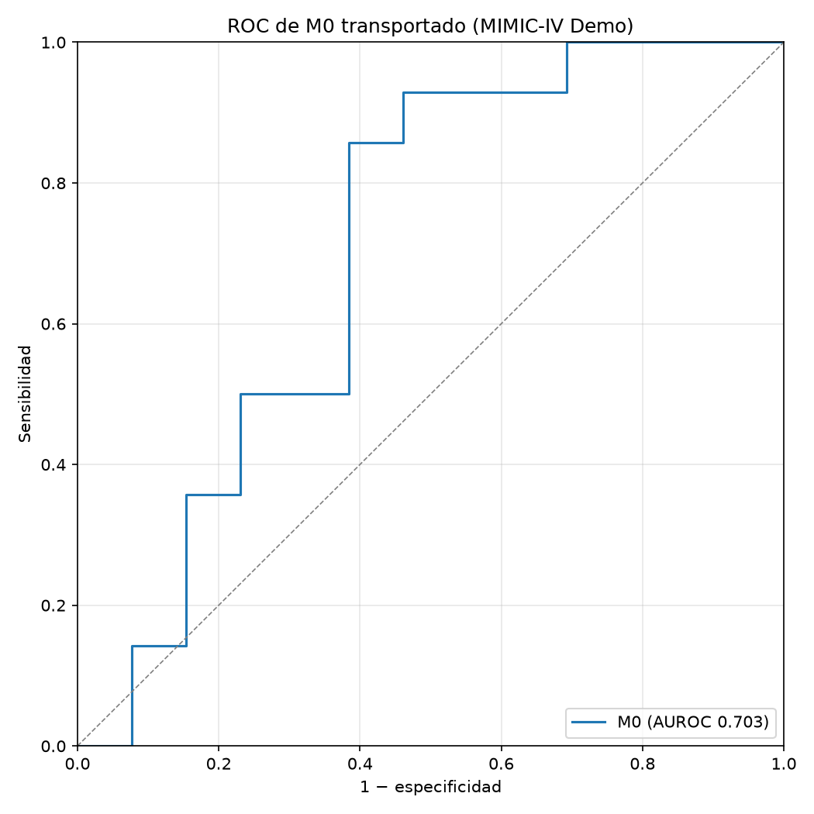
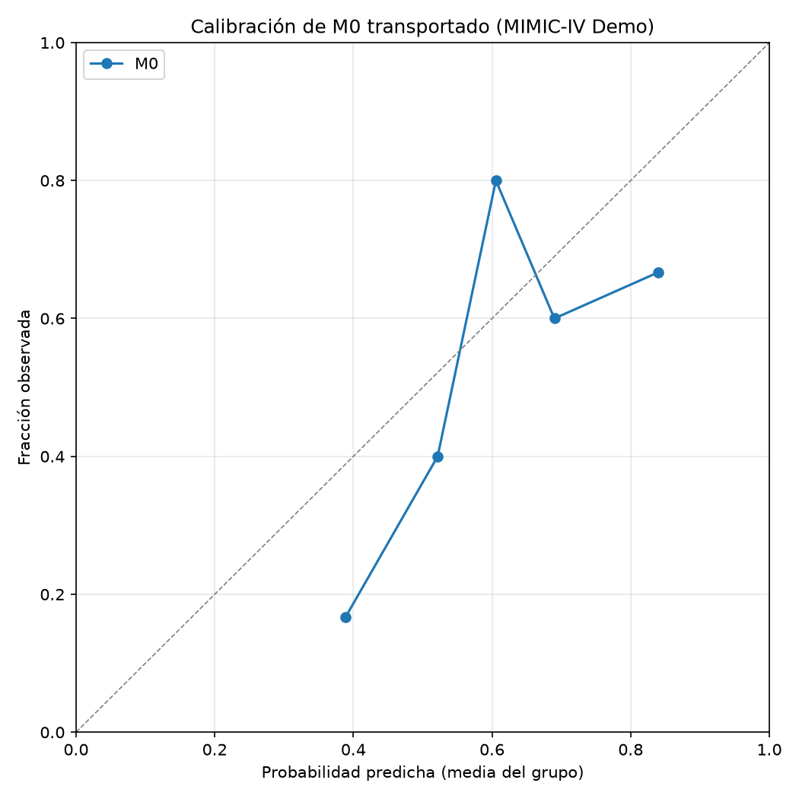

# Validación externa en MIMIC-IV Demo

Se transporta solo M0 (HFRS) ajustado en Synthea hacia la *MIMIC-IV Clinical Database Demo* v2.2, complementada con la *MIMIC-IV-ED Demo* v2.2 para las visitas a urgencias que no se convierten en ingreso. Ambas son de acceso abierto en PhysioNet, licencia ODbL v1.0, y se leen desde una ruta **fuera del repositorio** (por defecto `~/datos/mimic-iv-demo` y `~/datos/mimic-iv-ed-demo`). En este documento no hay identificadores de persona.

En el conjunto de desarrollo de la tesis (Synthea, n = 5,372 con seguimiento completo, prevalencia 37.4 %) el AUROC fuera de pliegue fue 0.600 (M0), 0.734 (M3) y 0.810 (XGBoost).;
## Cómo se construyó la cohorte en la demo

- Edad al egreso: `anchor_age + (año del dischtime − anchor_year)`. El año ancla está desplazado por paciente; los intervalos relativos se conservan. Las edades de 89 años o más suelen aparecer como 91
- Índice: primer egreso con edad ≥ 65 en un ingreso de tipo hospitalario (EW EMER., URGENT, ELECTIVE, DIRECT EMER., SURGICAL SAME DAY ADMISSION, OBSERVATION ADMIT). Se excluyen `EU OBSERVATION`, `DIRECT OBSERVATION` y `AMBULATORY OBSERVATION`.
- Se excluyen las muertes intrahospitalarias del índice (`hospital_expire_flag`, `deathtime` o `discharge_location = DIED`), porque el proyecto define la muerte postegreso con `death_date > cohort_start_date`.
- Desenlaces a 90 días, días 1-90 de calendario (no se cuenta el día 0): muerte (`dod` o un `deathtime` posterior), reingreso (otro `admittime`) o urgencias (`edstays.intime` de la demo de ED).
- El `dod` de MIMIC no es un seguimiento vital completo. El seguimiento se considera completo si hay un encuentro o un `dod` en o después del día 90, o si se observó la muerte (igual que en el proyecto: un reingreso o una urgencia por sí solos no cierran el seguimiento).
- Ventana del HFRS: diagnósticos de todos los ingresos cuyo `dischtime` cae en los 730 días hasta el egreso índice, inclusive. En MIMIC el diagnóstico no tiene fecha propia, solo `hadm_id`.
- El HFRS de Gilbert 2018 es de ICD-10 (109 códigos de 3 caracteres, más el ajuste G30 → F00). En la demo, la mayoría de los ingresos índice de 65+ están codificados en ICD-9 (era 2011-2013 / 2014-2016, Ocho códigos HFRS no tienen origen ICD-9 en el GEM (F00, J22, R02, R54, U80, X59, Y95, Z50); F00 se sigue asignando cuando aparece G30.

## Conteo (agregados de la demo)

- Pacientes en la demo clínica: 100.
- Ingresos de cualquier tipo con edad ≥ 65 al egreso: 116 (46 personas).
- Personas con al menos un egreso índice hospitalario ≥ 65: 46.
- Muertes en el ingreso índice (excluidas del análisis postegreso): 1.
- Cohorte postegreso (egresadas vivas): 45.
- De ellas, el ingreso índice era solo ICD-9: 36; solo ICD-10: 9.
- Diagnósticos en la ventana HFRS: 632 ICD-9 (191 mapearon a algún código HFRS) y 185 ICD-10.
- Eventos a 90 días en la cohorte postegreso (n = 45): muerte 5, reingreso 8, urgencias 9, compuesto 16.
- Seguimiento completo (regla del proyecto): 27 personas, con 14 eventos (prevalencia 51.9%).
- Personas con evento compuesto pero seguimiento incompleto (no entran al AUROC): 2.

Son pocos eventos. Los intervalos de confianza serán anchos; esta validación es exploratoria, no confirmatoria.

## Distribución del HFRS frente a Synthea

| Conjunto | n | Media | DE | Mediana | P25 | P75 | Mín | Máx |
|---|---:|---:|---:|---:|---:|---:|---:|---:|
| Synthea (desarrollo, seguimiento completo) | 5372 | 1.87 | 2.54 | 0.60 | 0.60 | 2.40 | 0.00 | 19.10 |
| MIMIC-IV Demo (cohorte postegreso) | 45 | 8.43 | 6.56 | 7.60 | 3.20 | 12.20 | 0.00 | 25.30 |

Categorías de Gilbert 2018 en la cohorte MIMIC postegreso: <5 = 17, 5-15 = 22, >15 = 6.

La demo es un hospital terciario real; Synthea es sintético y en esta corrida el HFRS de desarrollo puede estar mucho más concentrado en valores bajos. Esa diferencia de distribución, por sí sola, ya avisa que la calibración del M0 puede fallar aunque la discriminación se conserve.

## ¿Se puede validar M0?

Sí, con precaución: hay 14 eventos en 27 personas con seguimiento completo (umbral preespecificado: ≥ 10 eventos). Se aplican los coeficientes de Synthea, sin reajustar en MIMIC.

- Coeficientes de M0 en el desarrollo local: intercepto = -0.7370, coeficiente del HFRS = 0.1160 (n = 5,372, eventos = 2,009, prevalencia = 37.4%).
- AUROC en MIMIC: 0.703 [0.488-0.894]. El intervalo es bootstrap percentil de 1,000 réplicas (semilla 42) y se espera que sea ancho.
- Calibración-en-lo-grande (observado − predicho): -0.091.
- Pendiente de calibración (recalibración logística de logit(p)): 0.83 (1 = ideal).
- Razón observado/esperado: 0.85 (14 eventos observados, 16.45 esperados según M0).

Un AUROC con n tan pequeño no permite concluir que M0 «funciona» o «no funciona» en MIMIC; solo indica la dirección de la evidencia en esta muestra pública. La pendiente y la razón O/E también son inestables con pocos grupos de calibración.

## Por qué no se transportan M3 ni XGBoost

M3 tiene 37 columnas y XGBoost usa las mismas. Varias son específicas de Synthea o exigirían un mapeo que no está en el repositorio. Con n ≈ 30 tampoco hay potencial para 37 predictores. M1 (HFRS, edad y sexo) sí es transportable, pero al haber pocos eventos un modelo de tres parámetros es exploratorio.

| Variable | Modelo | ¿Disponible en la demo? | Comentario |
|---|---|---|---|
| `hfrs` | M0 | Sí | ICD-10 nativo (3 caracteres) más GEM CMS 2018 para ICD-9. |
| `edad` | M1 | Sí | anchor_age + (año del egreso − anchor_year). Los 89+ suelen aparecer como 91. |
| `sexo_masc` | M1 | Sí | Columna gender de patients. |
| `dm2_dx, ic_dx, erc_dx, demencia_dx, cardiop_isq_dx, hta_dx, anemia_dx` | M2 | Parcial | Habría que redefinir los mapas en ICD-9/ICD-10; el SQL del proyecto usa SNOMED/OMOP de Synthea. |
| `n_ingredientes_365, n_ingredientes_30` | M2 | No | Son recuentos de ingredientes OMOP de Synthea. En MIMIC hay prescriptions, pero no es el mismo concepto. |
| `dm_inferida, hta_inferida, ic_inferida` | M2 | No | Reglas de fármacos construidas sobre el formulario de Synthea. |
| `albumina_ultima, creatinina_ultima, urea_ultima, hemoglobina_ultima, tfge_ultima, pendientes, n, de` | M3 | Parcial | labevents existe y se podría mapear por itemid; no se implementó para no fingir un transporte. |
| `pas_ultima, imc_ultimo` | M3 | Parcial | Aparecen en omr y en registros de urgencias; hace falta un mapeo que aquí no se hace. |
| `n_ambulatorias_365` | M3 | No | MIMIC-IV es un recorte hospitalario; no hay consultas ambulatorias comparables a Synthea. |
| `n_hosp_365, n_urgencias_365` | M3 | Parcial | Se pueden contar admissions y edstays previas; no se transporta M3. |
| `estancia_indice_dias` | M3 | Sí | dischtime − admittime del ingreso índice. |
| `urea_falta, hemoglobina_falta, pas_falta, imc_falta` | M3 | Parcial | Dependen de que los laboratorios o signos se hayan mapeado. |

## Limitaciones

- La demo tiene 100 pacientes; después de edad, tipo de ingreso y muerte índice queda una muestra pequeña.
- El seguimiento vital es incompleto (`dod` no equivale a un `observation_period`). La pérdida de seguimiento puede disfrazarse de «sin evento».
- Las fechas están desplazadas; no se pueden interpretar calendarios reales, solo intervalos.
- Los coeficientes de M0 salen de un único ajuste en el desarrollo, no de las predicciones fuera de pliegue que se reportaron en `docs/modelos.md`.
- No se versionan datos de MIMIC: solo agregados y figuras sin identificadores.
