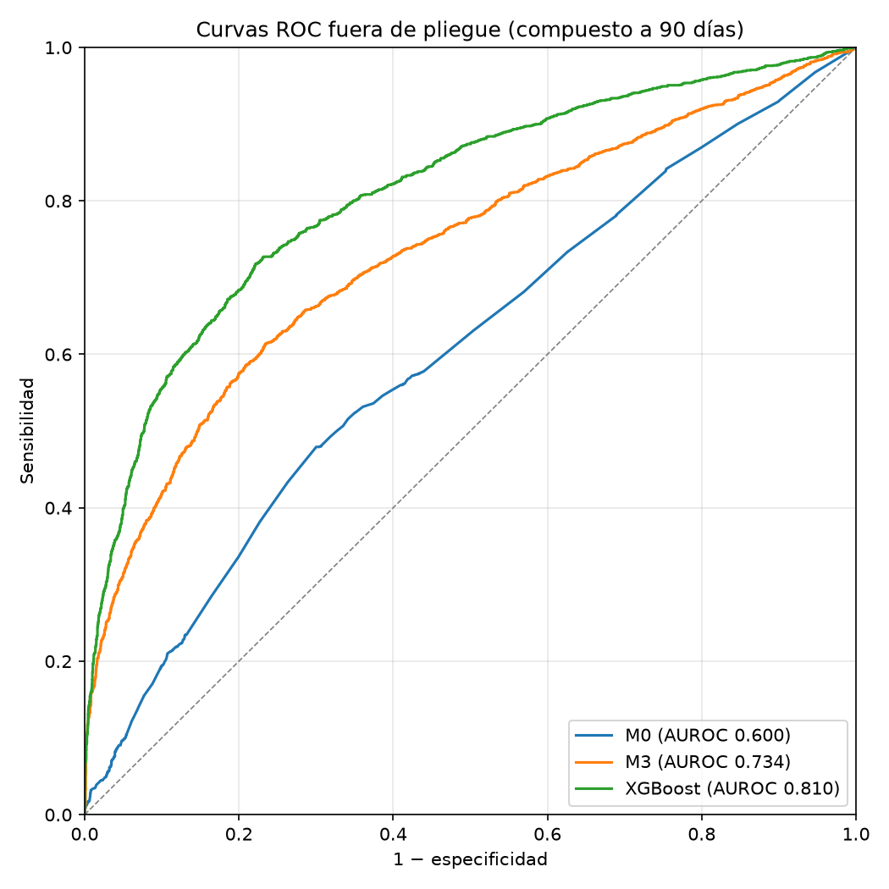
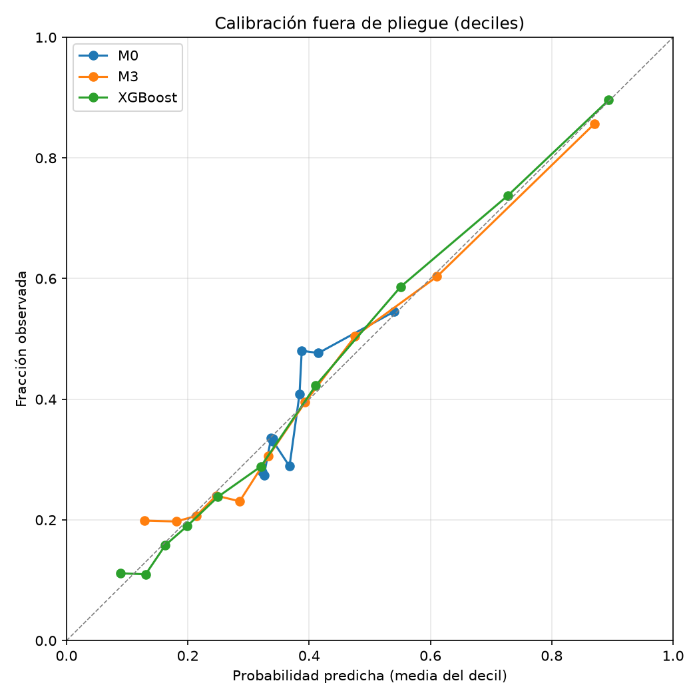
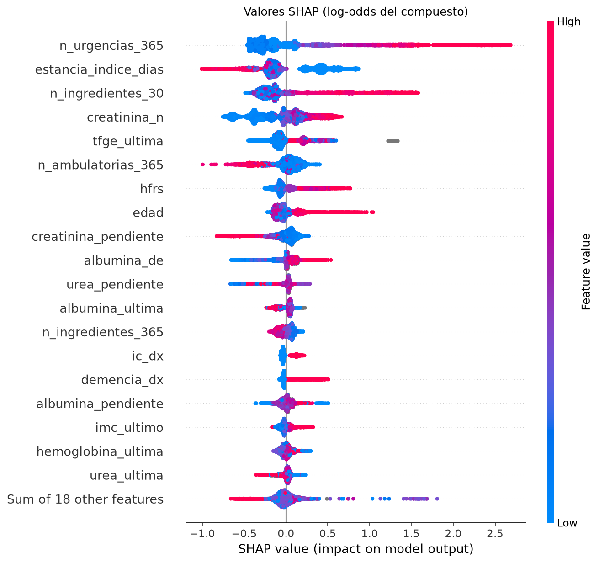
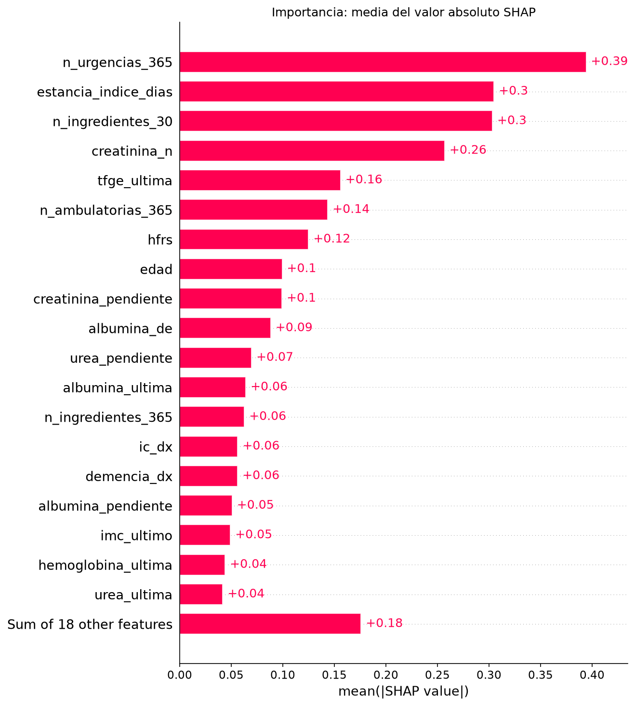
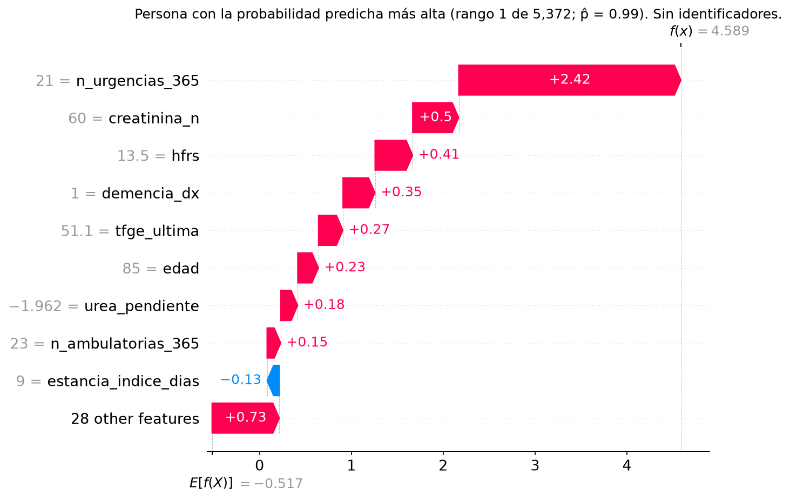

# XGBoost y valores SHAP del compuesto a 90 días

El XGBoost usa las mismas 37 variables de M3 y los mismos 5 pliegues estratificados (semilla 42) que la logística, en las 5,372 personas con `seguimiento_completo` (2,009 eventos, prevalencia 37.4 %). A diferencia de la logística, no se imputan los faltantes: XGBoost los maneja de forma nativa al enviar cada valor faltante a una dirección de división aprendida. Tampoco se estandariza.

Hiperparámetros fijos (sin búsqueda): `n_estimators=300`, `max_depth=3`, `learning_rate=0.05`, `subsample=0.8`, `colsample_bytree=0.8`, `min_child_weight=5`, `reg_lambda=1.0`, `random_state=42`, `tree_method=hist`, `n_jobs=1`.

Las predicciones de discriminación son fuera de pliegue. El AUROC, la AUPRC y las diferencias frente a M0 y a la logística M3 llevan IC 95 % bootstrap percentil (1000 réplicas, semilla 42, comparaciones pareadas).

## Discriminación

| Modelo | AUROC [IC 95%] | AUPRC [IC 95%] | ΔAUROC vs M0 [IC 95%] | ΔAUROC vs M3 [IC 95%] |
|---|---|---|---|---|
| M0 | 0.600 [0.584-0.617] | 0.471 [0.449-0.493] | — | — |
| M3 | 0.734 [0.720-0.749] | 0.672 [0.649-0.693] | 0.134 [0.114-0.152] | — |
| XGBoost | 0.810 [0.798-0.823] | 0.750 [0.731-0.769] | 0.210 [0.192-0.226] | 0.076 [0.065-0.087] |

La AUPRC de un clasificador nulo (prevalencia) sería 0.374.

## Calibración fuera de pliegue

| Modelo | Pendiente | Calibración-en-lo-grande (obs − pred) |
|---|---:|---:|
| M0 | 0.99 | +0.000 |
| M3 | 0.90 | +0.000 |
| XGBoost | 1.03 | +0.000 |

## Valores SHAP

El modelo de SHAP se ajusta con todas las personas de seguimiento completo (no es el modelo fuera de pliegue). Los valores explican el margen (log-odds), no la probabilidad. Las figuras no muestran `person_id` ni ningún otro identificador: el ejemplo individual es la persona con la probabilidad predicha más alta (rango 1 de 5,372; p̂ = 0.99).

### Dirección del HFRS

La correlación entre el HFRS y su valor SHAP es 0.77 (n = 5,372). Un HFRS más alto se asocia con valores SHAP positivos: aumenta el log-odds del compuesto (más riesgo predicho). Eso es coherente con el HR univariado y con el HR ajustado del Cox de M3 si ambos apuntan en la misma dirección.

## Limitaciones

- Los hiperparámetros son fijos; no hay búsqueda interna.
- El SHAP describe un modelo ajustado con toda la muestra de análisis, no las predicciones fuera de pliegue.
- Los pliegues son aleatorios estratificados, no un corte temporal.
- XGBoost no imputa, pero la dirección en la que envía un faltante es una regla del árbol, no un modelo explícito de no respuesta.
- Las figuras de SHAP muestran como máximo 20 variables.
